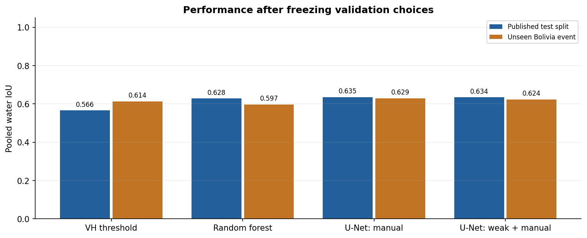

# FloodScope: Flood Mapping with Satellite Radar

For this project, I use real Sentinel-1 satellite radar measurements to map water during flood events and compare a VH threshold with a random forest and a small U-Net so I can see which method performs best on the reserved images. I also train the same U-Net on extra automatically labeled images before using the manual labels to check whether that extra training improves its predictions.

The main walkthrough is in **[floodscope.ipynb](floodscope.ipynb)** where I explain how I prepare the data and train the models before comparing their results through tables, training curves and examples of correct and incorrect predictions. I also reload the selected model and export a GeoTIFF to check that the saved files can produce the same predictions.



## What I used

- Dataset: [Sen1Floods11 v1.1](https://github.com/cloudtostreet/Sen1Floods11) with all 446 manually labeled patches and 80 selected automatic-label patches of which 80 passed the spatial overlap check.
- Published splits: 252 training images, 89 validation images, 90 ordinary test images and 15 Bolivia images with Bolivia kept outside training, validation and weak pretraining.
- Inputs: VV and VH radar measurements in dB using the dataset's existing preprocessing.
- Image size: 256 × 256 for all methods after reducing the original 512 × 512 grid.
- Training: my CPU with four threads and seed 42 using a U-Net with 122,393 parameters.

The labels describe **water** which includes permanent rivers and lakes so the scores measure water segmentation during flood events. I also compare the predictions with the JRC permanent-water reference to illustrate a candidate flood mask although I have not measured flood-only accuracy separately.

## Results

| split   | model                 | water_iou | precision | recall | f1     |
| ------- | --------------------- | --------- | --------- | ------ | ------ |
| test    | vh_threshold          | 0.5658    | 0.7447    | 0.7019 | 0.7227 |
| test    | random_forest         | 0.6283    | 0.8080    | 0.7386 | 0.7717 |
| test    | unet_manual           | 0.6348    | 0.7799    | 0.7733 | 0.7766 |
| test    | unet_weak_then_manual | 0.6343    | 0.7734    | 0.7792 | 0.7763 |
| bolivia | vh_threshold          | 0.6139    | 0.8725    | 0.6744 | 0.7608 |
| bolivia | random_forest         | 0.5970    | 0.8936    | 0.6426 | 0.7476 |
| bolivia | unet_manual           | 0.6294    | 0.8547    | 0.7048 | 0.7726 |
| bolivia | unet_weak_then_manual | 0.6240    | 0.8594    | 0.6949 | 0.7684 |

I selected **`unet_manual`** using pooled validation water IoU before scoring either checking split so the test answers did not determine which method I chose. The ordinary test split checks new patches from events already represented in development while Bolivia checks an event that stayed outside training and validation.

I ignore reference pixels without reliable answers in both the loss and the metrics and calculate every score on the prepared 256 × 256 grid which means these results are not directly comparable with published scores at the original resolution.

I trained each U-Net for 18 manual-label epochs with four extra pretraining epochs for the weak-label model and selected the checkpoints and probability thresholds using validation only. The complete experiment took **18.08 minutes** on my machine although the runtime will depend on the hardware used.

### Did the extra labels help?

- bolivia: weak pretraining changed water IoU by **-0.54 percentage points**.
- test: weak pretraining changed water IoU by **-0.04 percentage points**.

This comparison uses one seed and a limited weak-label sample with extra training time for the pretrained model so I use it to describe what happened under these settings without claiming that either method will always perform better.

## Run it locally

Use Python 3.12 and run these commands from this folder:

```bash
python3.12 -m venv .venv
source .venv/bin/activate
python -m pip install -r requirements.txt
python -m src.prepare_data
python -m src.experiment
```

The data command downloads approximately 865 MB through public HTTPS links and verifies the file sizes and MD5 checksums before saving the source generations and SHA-256 checksums in `data/manifest.json`. I exclude the environment, raw data and prepared cache through `.gitignore` so they can be downloaded separately when sharing the repository while the source data remain subject to their provider's terms and attribution requirements.

Open `floodscope.ipynb` in VS Code or Jupyter and select this folder's `.venv/bin/python` interpreter to use the saved results without training again. Set `RETRAIN = True` or run `python -m src.experiment --force` to repeat training. I reused the existing system PyTorch and pandas packages for the original run although a fresh environment can install all the dependencies through `requirements.txt`.

To predict a matching two-band VV/VH GeoTIFF:

```bash
python -m src.predict path/to/sentinel1.tif results/my_water_prediction.tif
```

The input should match Sen1Floods11's calibrated and georeferenced dB preprocessing with the same VV/VH band order and an approximately 5 km patch footprint. The command prepares an individual patch on a 256 × 256 grid and preserves its geographic extent through the updated transform with `0` for not water, `1` for water and `255` for invalid radar input.

## Files for checking the work

| File                              | Purpose                                                       |
| --------------------------------- | ------------------------------------------------------------- |
| `floodscope.ipynb`                | Notebook with the explanations and executed results           |
| `src/prepare_data.py`             | Public data download and integrity checks                     |
| `src/data.py`                     | Shared radar and label preprocessing                          |
| `src/model.py`                    | U-Net architecture and masked loss                            |
| `src/experiment.py`               | Training and validation selection followed by checking        |
| `src/predict.py`                  | Reloaded-model inference and GeoTIFF output                   |
| `models/selection.json`           | Method selected using validation                              |
| `models/*.pth`                    | Both trained U-Net checkpoints                                |
| `models/random_forest.joblib`     | Trained forest and its threshold                              |
| `results/metrics.csv`             | Aggregate measurements                                        |
| `results/per_chip_metrics.csv`    | Per-image scores and confusion counts                         |
| `results/config.json`             | Fixed settings and dataset-manifest fingerprint               |
| `results/data_audit.json`         | Split separation and spatial-overlap checks                   |
| `results/verification.json`       | Checks for model reloads, metrics, ignored labels and exports |
| `results/notebook_execution.json` | Full notebook execution record                                |

Run `python -m src.verify` to repeat the saved-model and export checks or use `python execute_notebook.py` to execute every notebook cell with the current interpreter and save the outputs. The `python build_notebook.py` command rebuilds the notebook without outputs so run the execution script afterwards if you use it.

## Limits and next steps

I have checked one completely unseen event and one ordinary test split so these results do not establish operational reliability or performance on Philippine flood imagery. The manual labels contain ignored and uncertain regions while the automatic labels can contain classification mistakes and reducing the image size removes smaller details. I would need to repeat the comparison with more seeds and unseen events and check larger weak-label samples and independently labeled local cases before making broader claims about flood mapping.
